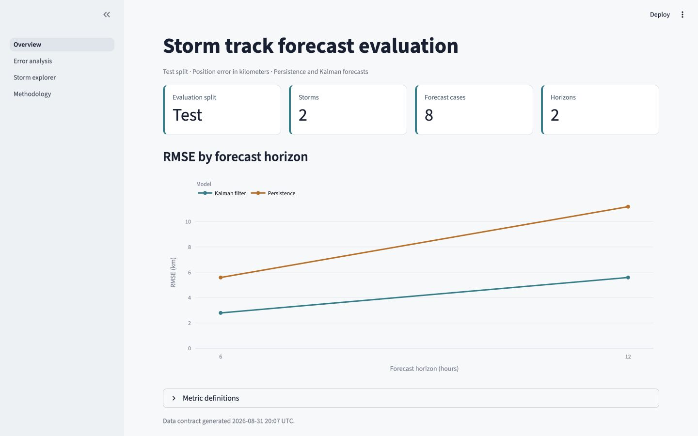

# Probabilistic Storm Tracks

This project compares a persistence forecast with an adaptive constant-velocity Kalman filter on global tropical-cyclone tracks from IBTrACS. The Python package contains the model and evaluation logic, thin notebooks provide an exploratory interface, and Streamlit presents validated results.



The screenshot uses a two-storm fixture to show the interface. It is not a full-data result.

## Current status

The code now uses storm-level train, validation, and test splits, matched forecast cases, and one definition of position error and RMSE. The full IBTrACS workflow was not rerun during this refactor because preparation and evaluation are expensive. Existing result tables are retained in `artifacts/historical_dashboard/`, but they do not satisfy the current split-provenance contract and are not loaded by the app.

See [Results and limitations](docs/results_and_limitations.md) before interpreting any tracked result.

## Quick start

Python 3.11 or newer is required.

```bash
python -m pip install -e ".[app,notebooks,dev]"
```

Preview every pipeline stage without reading the dataset or running a model:

```bash
python scripts/run_pipeline.py --dry-run
```

Run the tests and static checks:

```bash
python -m pytest -q
python -m ruff check src scripts app tests keep_alive
```

## Data and full workflow

Download the IBTrACS v04r01 all-storm CSV from [NOAA NCEI](https://www.ncei.noaa.gov/products/international-best-track-archive) and save it as `data/ibtracs.ALL.list.v04r01.csv`, or change `paths.raw_data` in `configs/pipeline.toml`.

The full run is intentionally explicit because it can take a long time:

```bash
python scripts/run_pipeline.py --execute
```

The stages are:

| Stage | Reads | Writes | Typical cost |
| --- | --- | --- | --- |
| `prepare_data` | Raw IBTrACS CSV | `data/hurricane_paths_processed.pkl` | Long |
| `run_models` | Processed tracks | Split-named model pickles, summaries, and metadata in `data/` | Long |
| `build_dashboard_data` | Paired model results and processed tracks | Versioned Streamlit contract in `app/data/` | Medium |

The default evaluation split is `test`. Change the split and model settings in `configs/pipeline.toml`; the runner passes those values to each stage.

To rebuild only the app contract from existing model outputs:

```bash
python scripts/build_dashboard_data.py \
  --persistence-results data/test_persistence_results.pkl \
  --kalman-results data/test_kalman_results.pkl \
  --tracks data/hurricane_paths_processed.pkl \
  --output-dir app/data \
  --headline-split test
```

Then start Streamlit:

```bash
streamlit run app/app.py
```

More detail is available in [the app guide](app/README.md) and [the regeneration guide](docs/regenerate_dashboard_data.md).

## Evaluation contract

- Complete storms stay within one train, validation, or test split.
- Noise covariances are estimated from training storms only.
- Persistence and Kalman results must contain the same storm, origin, horizon, and split keys.
- Position error is Euclidean distance in the local track coordinate system, in kilometers.
- RMSE is the square root of the mean squared position error.
- Improvement is persistence RMSE minus Kalman RMSE, so a positive value favors the Kalman filter.
- Supported forecast horizons are 6, 12, 24, 48, and 72 hours.

## Repository map

```text
app/                 Streamlit entry point, pages, and schema-v1 loader
artifacts/           Historical outputs, figures, and archived notebooks
configs/             Pipeline settings
docs/                Architecture, methods, reports, references, and run guides
notebooks/           Thin numbered exploration workflow
scripts/             Preparation, evaluation, orchestration, and export commands
src/storm_tracks/    Reusable data, feature, model, evaluation, and export logic
tests/               Unit, integration, notebook, app, and artifact checks
```

Start with [Architecture](docs/architecture.md) when changing module boundaries. Use `notebooks/00_run_all.ipynb` to inspect or launch the ordered workflow from Jupyter without duplicating its implementation.

## Historical result snapshot

The preserved pre-refactor summary reports lower persistence RMSE at every horizon:

| Horizon | Kalman RMSE (km) | Persistence RMSE (km) |
| ---: | ---: | ---: |
| 6 h | 21.66 | 17.84 |
| 12 h | 45.36 | 39.26 |
| 24 h | 103.50 | 94.95 |
| 48 h | 252.78 | 241.90 |
| 72 h | 440.59 | 427.91 |

These numbers are descriptive historical artifacts, not corrected held-out results: the tracked rows do not record train, validation, or test membership. Do not use them to make current performance claims.

## Reports and references

- [Technical report](docs/reports/sequential_bayesian_inference_applied_to_hurricane_tracking.pdf)
- [Results and limitations](docs/results_and_limitations.md)
- [Notebook guide](notebooks/README.md)
- [IBTrACS construction paper](docs/references/kruk_2010_ibtracs_global_best_track_construction.pdf)

The project is released under the [MIT License](LICENSE).
